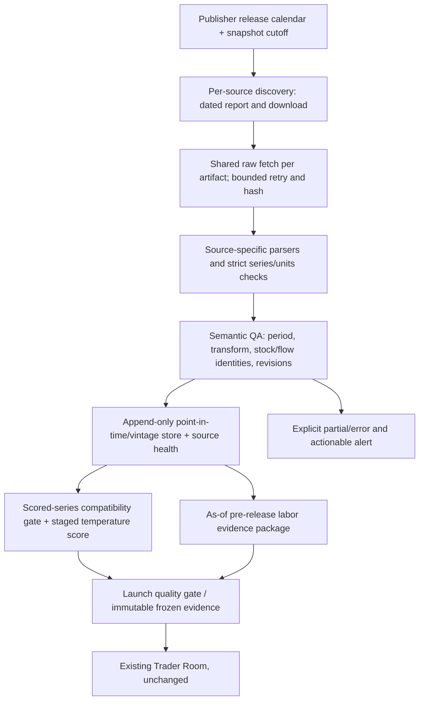
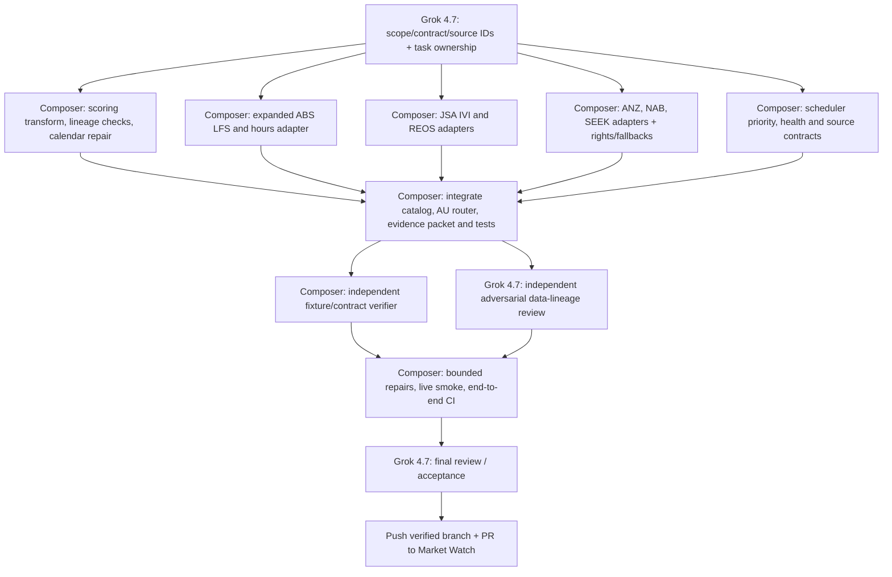

# Australian Labor Data Reliability Repair
**Status:** Review/design only. No implementation or Cursor dispatch authorized by this plan.
**Date:** 2026-10-14
**Repository:** `McCabeAI/market-watch-public-dashboard`
**ACP contract read:** `McCabeAI/agent-control-plane/README.md` on `main`, blob SHA `9d19249a3c68fa649dd9d153f9efa4e3e2803190`. ACP remains unchanged.

## 1. Verified failures and diagnostic evidence

- Australian September 2026 Labor Force release is **2026-10-15 11:30 AEDT**, per ABS. The catalog / `data/macro_ingestion/fragments/au.json` incorrectly binds September observations to **2026-10-16 11:30 +11:00**. Correct the calendar from official release schedules, with reference-period binding and DST regression tests.
- `AU.Labor.unemployment` official series `A84423050A`: catalog transform `unemployment_rate_sa`; frozen calibration and canonical history require `percent`. `scripts/macro_ingestion/canonical_bridge.py` rejects the otherwise valid August value `4.6462961` by `partial_transform_mismatch`. This is a silent contract failure because the 2026-10-14 run ledger reports `new_observation` but the launch lineage reports `appended_count=0`. Fix identity and preserve economic units, weights, raw evidence, and existing observations. Include all scored-series catalog/calibration/history transform/series-id checks; review other mismatches without expanding scope indiscriminately.
- 2026-10-14 launch `mwl-20261014T093138Z-d6061bbe` acquired official August employment `39.4933371k`, unemployment `4.6462961%`, participation `67.0582068%`; the canonical AU unemployment score still referenced July. Launch `07_finalize` says promoted, but promoted **unchanged** score state. This must no longer qualify as fully successful lineage integration.
- `scripts/macro_ingestion/runner.py` reserves critical due-labor first-pass/retry priority for US labor IDs only (`PROTECTED_LABOR_IDS`); AU due employment and unemployment receive ordinary scored priority.
- Current ABS parser fetches individual workbook series through `scripts/macro_ingestion/adapters/au.py` even when series share a single source workbook. Introduce shared raw-fetch/cache per release, parse once, validate series IDs, reject HTML/challenge artifacts, maintain raw SHA/source URL.
- `.github/workflows/macro-ingestion.yml` is **manual-only** (with PR validation); a human Market Watch launch may do its own ingestion. No unattended AU-leading-indicator acquisition exists. Production Trader Room remains manual and unchanged.
- Existing `AU.Labor.participation` release dates stop at the August release. Extend all required calendars via publisher schedules. Avoid treating an exhausted pinned-date list as “not due.”
- ABS 2026 Labor Force survey modernisation may affect comparability around August; retain methodology-break annotation, avoid arbitrary trend extrapolation.

## 2. Source coverage, precedence, and availability

**P0, official release inputs:** ABS headline labor force (seasonally adjusted employment stock/change, unemployment and labor force, participation, employment-to-population, full-time and part-time employment, underemployment, underutilisation); ABS hours worked (separate workbook). Discover exact series IDs and column locations from live publisher artifacts. Existing Table 001 workbook is `62020001.xlsx`; hours worked may use Table 017. Verify source workbook identity and available corresponding ABS SDMX dataflow rather than guessing dataflow keys.

**P1, leading indicators available before the ABS print when actually published:**
- ANZ–Indeed Australian Job Ads; first choice is ANZ publisher's downloadable dated XLSX data (seasonally adjusted and trend kept distinct). October 6, 2026 release covers September.
- NAB Monthly Business Survey employment subindex (October 13 release covers September). Acquire a dated publisher report/chart-pack and the **numeric employment series only if legitimately accessible and parser-verified**. If only qualitative commentary is available, store dated qualitative context separately; do not manufacture numeric index values.
- Jobs and Skills Australia (JSA) Internet Vacancy Index (IVI), national seasonally adjusted levels and monthly changes, XLSX source; September IVI is not published until **October 21**, so only August qualifies for the October 15 jobs forecast.
- JSA Recruitment Experiences and Outlook Survey (REOS): percentage of businesses recruiting, recruitment difficulty, percentage planning staff increases, each with reported coverage and vintage.
- SEEK Employment Report job-ad trend, applications/ad and geographic/industry composition where explicitly dated and terms permit. As of October 14, 2026 the latest verified release is **August 2026** (September date-less page cannot be assumed 2026). Report trend versus seasonally adjusted methodology and known series breaks.

**P2 context:** JSA Total New Vacancies quarterly, migration/labor supply, job vacancies and wages, PMI employment subcomponents where licensed, business confidence. Do not block P0 delivery waiting for P2. No deprecated ABS Weekly Payroll Jobs or Monthly Employee Earnings Indicator as fresh monthly proxies.

Primary source URLs:
- https://www.abs.gov.au/statistics/labour/employment-and-unemployment/labour-force-australia
- https://www.abs.gov.au/release-calendar/future-releases
- https://data.api.abs.gov.au/rest/
- https://www.anz.com.au/newsroom/media/2026/october/job-ads-up-again/
- https://www.jobsandskills.gov.au/data/internet-vacancy-index
- https://www.jobsandskills.gov.au/data/recruitment-experiences-and-outlook-survey
- https://www.jobsandskills.gov.au/data/total-new-vacancies
- https://www.nabtrade.com.au/insights/news/2026/10/nab-business-survey---september-2026
- https://au.seek.com/about/news/category/seek-employment-reports/0

## 3. Target architecture

- Use source-specific adapters behind existing `scripts/macro_ingestion/` contracts; avoid changing the locked calibration or creating a second macro universe.
- Raw acquisition stores SHA256, publisher URL, retrieval time, actual document release date, reference period, adjustment method, series ID, units, revision vintage and first-seen time. For correlated series in one workbook, fetch once, parse multiple columns.
- For pre-release intelligence, use **information available at the requested snapshot timestamp**, not the latest revised spreadsheet. Maintain first-seen releases and preserve later revisions.
- `verified`, `not yet due`, `due missing`, `transient failure`, `schema drift`, `license gap`, `budget deferred` should be distinguishable through existing ledger statuses and granular error metadata. Do not alter status vocabulary without a deliberate versioned migration.
- Fix scored transform/series compatibility. If an observed scored point qualifies as a new release and is not carried into staged score lineage, surface the exact rejection and fail the score integration gate; never report a successful promotion of unchanged scores as evidence acceptance.
- Leading sources feed the evidence/research layer with zero temperature-score weight initially; model use is a separate later decision validated by point-in-time backtests.
- Due ABS unemployment/employment missing after an appropriate publication grace period must block fresh AU risk as per existing country-level gate. Missing optional P1 source marks AU labor intelligence as `partial`, never fabricates observations or blocks unrelated countries.
- Preserve current stage 01–08 boundaries, post-freeze semantics, immutable packet hashes, and no changes to seats, PM decisions or ACP.

## 4. Resilience rules

1. **Calendars:** fetch/verify ABS published schedule with Australia/Sydney timezone, expected reference period and known release-time exceptions. Ensure a forward-looking 6-month calendar and warn if calendar coverage expires. Keep a release calendar fixture/test. Do not roll explicitly published ABS releases to another business day. For others, publisher-specific release discovery and expected delays.
2. **Fetch reliability:** transport retry only for timeouts/429/5xx, bounded by per-source budgets, with rate-limit handling. A 404 before publication is `not due`, not stale data; after publication grace it becomes explicit `due missing`. No substitution of older month's workbook on a current month's URL. A 403/challenge/license wall remains a gap, not a fabricated successful fetch.
3. **Parsing:** validate MIME/file magic, sheet names, expected series IDs, units, observation dates, reported vintages, finite values, numerical ranges, correct seasonality, and consistency of identity relationships with tolerances. Do not silently select “closest matching” columns.
4. **Priority and isolation:** give due AU official labor a protected lane independent of US source failures. Fetch high-value independent P1 feeds without allowing them to starve core ABS. Shared download and distributed independent source budgets prevent duplicate work.
5. **Lineage and data integrity:** keep canonical calibration invariant. Validate `catalog -> observation store -> history -> staged score -> accepted score -> frozen evidence` for exact series/transform, period and hash. A successful fetch alone is insufficient. Preserve last verified not-due observations with true vintage and publish partial flags.
6. **Health and alerting:** per-series expected/observed period, checked_at, first_seen, last_success, age, source URL/hash, failure class, retry count and reason for exclusion; actionable summary for missing due core labor and 2 consecutive leading-source failures. Never silently degrade.
7. **Automation boundary:** deterministic scheduled collection in the target repo **only if separately approved**, with an as-of snapshot shortly before releases and a post-release verify/retry window. Do not schedule traders/PMs or use provider credentials in repository Actions; provider/model recurrence belongs exclusively to ACP if ever explicitly approved.

## 5. ACP Cursor execution DAG (future explicit launch only)

Use exact authenticated provider IDs for Grok 4.7 and Composer (check model registry at launch; never substitute). Parent Grok owns architecture and final approval; Composer owns bounded implementation, independent verification and mechanical remediation. Isolate file ownership: C2/C3/C4 separate adapters/tests; C1 owns AU catalog fragment/lineage compatibility fixtures; C5 runner/ledger/test priority. Only integrator edits generated catalog and shared dispatch. Independent verifiers do not approve their own changes. Limit each remediation loop; escalate unresolved logic to parent.

**ACP launch mechanics:** Create one authorized `[agent-run]` issue targeting `McCabeAI/market-watch-public-dashboard`, `provider=cursor`, `execution_profile=agentic-build`, `starting_ref=main`, `max_attempts=1`, parent model Grok 4.7 and Composer/Grok-only internal subagent allowlist, constraints, task graph, named acceptance criteria. `submitted` is not launched: read ACP control receipt and require `Launch state: launched` with provider run ID. Unknown acceptance blocks overlapping launch. ACP does not automatically retry or follow up; any additional provider call needs fresh authorized command. Inspect actual pushed branch/PR after provider finishes. ACP is control only and **must not be modified**. `config/schedules.v1.json` currently includes a disabled `market-watch-weekday-0205` schedule; leave it disabled. Verified repository `.cursor/hooks.json` has subagent policy and runtime hooks.

## 6. Test and delivery acceptance

- Current August 2026 raw unemployment `4.6462961` goes through catalog, observation store, history, staged score and accepted score as `2026-08`; test no calibration change, no altered source observation, and exact hash/period lineage. First run updates, rerun idempotent. Any incompatibility fails with explicit rejection metadata.
- Oct 15 11:29 Australia/Sydney: September not yet due. Oct 15 11:30+ Australia/Sydney: September becomes due; wrong Oct 16 rule fails regression. Validate DST shift for October/November.
- Full-time + part-time reconciles total employment in ABS official units with rounding tolerance; unemployment and participation derived relationships reconcile; hours and underemployment stay distinct and correctly sourced. Detect bad sheet/column, mismatched series ID, revision, 404, 403/challenge, empty XLSX and stale month.
- Each P1 source parses at least one real publisher artifact and one offline fixture; every point has publisher, period, release timestamp, downloaded raw hash and units. Before-Oct-15 as-of package uses August JSA IVI and August SEEK, not unpublished September data.
- Validate scheduler critical-labor priority under simulated stalled US endpoints. No AU budget deferral when AU due job sources are available. No automatic model calls.
- Existing macro ingestion, temperature, launch quality, overnight and Trader Room suites pass; integration test reaches a frozen AU evidence packet without changing existing books/PM/risk. Run permissioned live source smoke and inspect artifacts.
- Git delivery: validate, commit, push a dedicated branch, open PR, report tests, source health, source access gaps, raw evidence hashes and final Grok approval. Do not merge or activate any new schedules without separate authorization.

## Decision requested

Approve a future **one-off ACP-dispatched Cursor implementation** using only Grok 4.7 and Composer, with no ACP code/config changes and no change to automated production scheduling unless separately approved.
